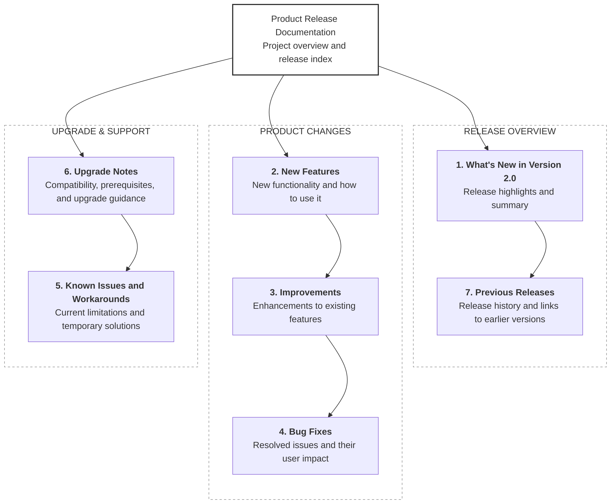

# Website

This website is built using [Docusaurus](https://docusaurus.io/), a modern static website generator.

## Installation

```bash
npm install
```

**Note**: feel free to use the package manager of your choice.

## Local Development

```bash
npm run start
```

This command starts a local development server and opens up a browser window. Most changes are reflected live without having to restart the server.

## Build

```bash
npm run build
```

This command generates static content into the `build` directory and can be served using any static contents hosting service.

## Deployment

Using SSH:

```bash
USE_SSH=true npm run deploy
```

Not using SSH:

```bash
GIT_USER=<Your GitHub username> npm run deploy
```

If you are using GitHub Pages for hosting, this command is a convenient way to build the website and push to the `gh-pages` branch.


```bash



```
