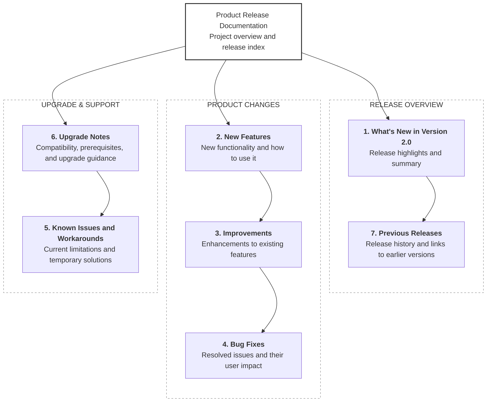

# Product Release Documentation

Product Release Documentation

Parent page — project overview and release index

1. What's New in Version 2.0

Release highlights and summary

2. New Features

New functionality and how to use it

3. Improvements

Enhancements to existing features

4. Bug Fixes

Resolved issues and their user impact

5. Known Issues and Workarounds

Current limitations and temporary solutions

6. Upgrade Notes

Compatibility, prerequisites, and upgrade guidance

7. Previous Releases

Release history and links to earlier versions

## Overview

Welcome to the FlowSpace Product Release Documentation. This space provides information about product updates, new features, improvements, bug fixes, known issues, and upgrade considerations for each FlowSpace release.

FlowSpace is a fictional project management platform designed to help teams organize projects, manage tasks, track progress, and collaborate effectively.

This documentation is intended to help users understand changes introduced in each release, learn how new functionality works, identify known limitations, and prepare for upgrades when necessary.

## Latest Release

**Current Version:** 2.0  
**Release Date:** October 12, 2026

FlowSpace 2.0 introduces custom dashboards, advanced task filters, and improved notification preferences. This release also includes enhancements to task board performance and search, along with fixes for issues affecting task status updates, report exports, and notification counts.

For a detailed summary, see [What's New in FlowSpace 2.0](#whats-new-in-flowspace-20).

## What's Included in This Documentation?

Use the following sections to explore the release documentation.

### 1. What's New in Version 2.0
Provides an overview of the latest release, including major highlights, key changes, and their benefits to users.

### 2. New Features
Describes newly introduced functionality and explains how users can access and use the available features.

### 3. Improvements
Summarizes enhancements to existing functionality and explains how these changes improve the user experience.

### 4. Bug Fixes
Documents resolved issues, describes their previous impact on users, and explains the corrections introduced in this release.

### 5. Known Issues and Workarounds
Lists current limitations, their potential impact, and available workarounds to help users continue working.

### 6. Upgrade Notes
Provides compatibility considerations, prerequisites, preparation steps, and general guidance for upgrading to a new version.

### 7. Previous Releases
Provides a release history with summaries of earlier versions and links to their documentation.

## Who Should Use This Documentation?

This documentation is intended for:

- **End Users:** To understand new features, improvements, and changes to existing workflows.
- **Project Managers and Team Leads:** To learn how product updates affect project management and team collaboration.
- **Administrators:** To review known issues, compatibility considerations, and upgrade guidance.
- **Support Teams:** To understand resolved issues, known limitations, and available workarounds.

## Release Documentation Structure

| Section | Purpose |
|---|---|
| What's New in Version 2.0 | Release overview and highlights |
| New Features | Newly introduced functionality |
| Improvements | Enhancements to existing features |
| Bug Fixes | Resolved issues and user impact |
| Known Issues and Workarounds | Current limitations and temporary solutions |
| Upgrade Notes | Compatibility and upgrade guidance |
| Previous Releases | Historical release information |

## Documentation Scope and Assumptions

This project demonstrates how product release documentation can be organized and maintained in Confluence.

FlowSpace is a fictional product created for a technical writing portfolio. The release details, dates, features, issues, and procedures presented in this documentation are illustrative examples and do not represent an actual software product.

In a production environment, release information should be reviewed and validated with the relevant product, engineering, and quality assurance teams before publication.

## Related Documentation

- [What's New](./What's-New.md)
- [New Features](./New-Features.md)
- [Improvements](./Improvements.md)
- [Bug Fixes](./Bug-Fixes.md)
- [Known Issues and Workarounds](./Known-Issues.md)
- [Upgrade Notes](./Upgrade-Notes.md)
- [Previous Release](./Previous-Releases.md)

---

**Document Owner:** Technical Writing Team  
**Product:** FlowSpace  
**Documentation Type:** Product Release Notes  
**Latest Documented Version:** 2.0

